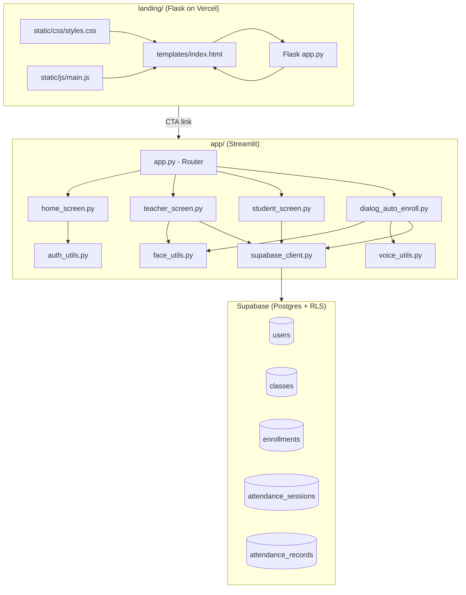

# Apni Kaksha — Architecture

## Project Overview

**Apni Kaksha** is an AI-powered attendance system with two sub-projects:

| Sub-project | Framework | Purpose |
|---|---|---|
| `landing/` | Flask + Jinja2 | Marketing landing page (Vercel-deployed) |
| `app/` | Streamlit | Main attendance application |

---

## System Architecture



---

## Screen Routing

`app.py` reads `st.session_state['login_type']`:

| Value | Screen shown |
|---|---|
| `None` | `home_screen` (login/register) |
| `"teacher"` | `teacher_screen` |
| `"student"` | `student_screen` |
| Any + `?join_code=` | `dialog_auto_enroll` (overlays student screen) |

---

## Face Recognition Pipeline

```
Camera input (bytes)
    ↓
face_utils.encode_face_from_bytes()
    ↓ resize to ≤640px, dlib HOG detector
    ↓ 128-D embedding (face_recognition library)
    ↓
JSON stored in enrollments.face_encoding
    ↓
On attendance: compare_faces() → Euclidean distance ≤ 0.5 → match
```

## Voice Recognition Pipeline

```
WAV audio upload (bytes)
    ↓
voice_utils.encode_voice_from_bytes()
    ↓ soundfile decode → resemblyzer preprocess_wav
    ↓ VoiceEncoder.embed_utterance() → 256-D d-vector
    ↓
JSON stored in enrollments.voice_encoding
    ↓
On attendance: cosine_similarity ≥ 0.75 → match
```

---

## Key Libraries

| Library | Version | Role |
|---|---|---|
| `streamlit` | 1.35 | App framework |
| `flask` | 3.0 | Landing page |
| `supabase` | 2.5 | Database client |
| `face_recognition` | 1.3 | dlib face encoding |
| `resemblyzer` | 0.1.1 | Voice embedding |
| `librosa` | 0.10 | Audio processing |
| `bcrypt` | 4.1 | Password hashing |
| `segno` | 1.6 | QR code generation |
| `scikit-learn` | 1.4 | ML utilities |
| `plotly` | 5.22 | Analytics charts |
| `pandas` | 2.2 | Data handling |

---

## Security Notes

- Only `SUPABASE_ANON_KEY` (public) is used — never the service-role key
- RLS enforces row-level access on all tables
- Passwords hashed with bcrypt cost factor 12
- Biometric encodings stored as JSON vectors — not raw images or audio
- All secrets loaded from `.env` via `python-dotenv`
